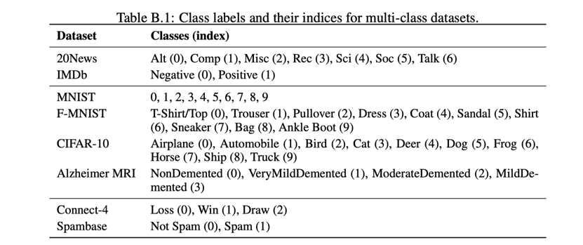
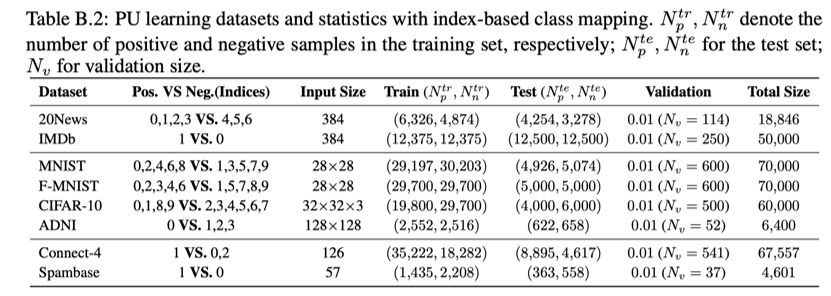

# PU Survey Experiment Protocol

> This protocol outlines the experiment requirements: objectives, data and splits,
> model-selection protocols, result grouping, and delivery acceptance. It is a lasting
> reference for the study design.
>
> Related documents: [experiment_layer.md](../../dev/experiment_layer.md) provides optional
> Chinese design and implementation background. See the [README](README.md) for current
> capability boundaries and the [runbook](runbook.md) for commands.
> [dual_architecture_plan.md, section 7](../../dev/dual_architecture_plan.md) provides optional Chinese
> background on architecture planning; [method cards](../method_cards/) provide optional
> Chinese research background on individual implementations and their limitations.

> **Revision, 2026-10-21:** Q1–Q3 and training-time clean support (section 2.4) were finalized.
> This revision adds paper-first adjudication of sampling assumptions and the
> “calibration not applicable” category; defines the canonical prior and view conversion;
> lists clean-support runs separately as `PA+clean-support` in the same table; and states
> architecture-exception criteria and recipe registration. See sections 1.2, 2.3, 2.4, 2.5,
> 3, 4, and 5.
>
> **Revision, 2026-11-08:** clean support covers all eight datasets. IMDB/20News support is
> carved from frozen-split SBERT features; ADNI support is carved from frozen-split raw images.
> ADNI permits only `group_policy="unverifiable"`, recording unverifiable subject isolation
> and owner approval `approved_by_protocol_owner_20261108`. The support seed must equal
> the split seed and be declared before inspecting labels. The execution matrix remains
> `survey-v3.2`, revision `2026-11-08-clean-support-coverage`; the recipe registry is
> `survey-recipes-v1.3`.
>
> New runs use `survey-v3.2` with that revision and `survey-recipes-v1.3`. Existing v3
> results are consumed read-only under their original records. Historical protocols and
> process records are available before cleanup at commit `7d11f2c4`; historical results
> are not relabeled as the new version.

## 0. References

1. *Accessible, Realistic, and Fair Evaluation of Positive-Unlabeled Learning Algorithms*
   (Wang et al., ICLR 2026).
   Source repository: https://github.com/wu-dd/PUBench
2. *PU-Bench: A Unified Benchmark for Rigorous and Reproducible PU Learning*
   (Chen et al., 2026).
   Source repository: https://github.com/XiXiphus/PU-Bench

## 1. Experiment objectives

This protocol chooses specific research conditions: OS input, SCAR or named LBE-A/B fixed-count
labeling, method-configured native-U or TS-compatible risk pools, the split-recorded population
prior, independent PA/OA selection, and specified representations.
For formulas and applicability conditions, see the public concepts on
[sampling](../../user/concepts/pu_sampling.md),
[labeling mechanisms](../../user/concepts/scar_sar.md),
[prior semantics](../../user/concepts/class_prior_semantics.md),
[model selection](../../user/concepts/pu_model_selection.md), and
[representations](../../user/concepts/representations.md).
New runs retain these dimensions in `research_settings`; reports preserve the original settings
per seed and display readable summaries.

### 1.1 Overview

1. What advantages do the different PU method categories offer, and under which conditions?
2. How stable are PU methods at different labeling frequencies?
3. How large is the gap to fully supervised learning, and where can methods improve?

### 1.2 Clarifications

- Objective 1 uses the Survey taxonomy: A. data inspired methods, B. objective inspired
  methods, and C. optimization inspired methods. Following reference 2, add a fully
  supervised oracle comparison outside these three categories as a reference upper bound;
  it is not a guaranteed empirical upper bound for every finite run.
- Assess an “advantage” through two **independent** model-selection protocols: PA, the main
  PU protocol, and OA, the oracle comparison using true validation labels. Each protocol
  separately selects hyperparameters and checkpoints, then reports independent true-label
  test Accuracy as the mean and standard deviation over five repetitions. AUC, F1 score,
  Precision, and Recall are additional final-test metrics recorded in run manifests and
  summaries. They do not select hyperparameters or checkpoints and are not combined with
  PA/OA into one score. F1/Precision/Recall use positive label `1`. When a metric is undefined
  because of degenerate test labels or predictions, record `null` and a reason, rather than
  inserting zero or discarding the run.
  Each protocol must select its own hyperparameters, checkpoint, and threshold: PA results
  use configurations selected on `pu_val`; OA results use configurations selected on
  `clean_val`. An OA-selected configuration cannot stand in for PA results.
- “Conditions” include the original dataset, sampling design, backbone, test metrics,
  class prior, labeling probability, and related parameters, including training time and peak
  GPU memory studied in reference 2.
- Objective 2 uses **label ratio / label frequency** for the mean proportion of true positives
  observed as labeled positives, as in references 1 and 2: $`c=P(S=1\mid Y=1)`$.
  It is distinct from the class prior, written separately as $`\pi=P(Y=1)`$.

## 2. Datasets

### 2.1 Dataset selection

Use eight datasets spanning images, text, and tables (references 1 and 2):

- Text: IMDB and 20News.
- Images: CIFAR-10, the ADNI slot, MNIST, and F-MNIST.
- Tables: Spambase and Connect-4.

> Follow PU-Bench's processing approach: fixed `all-MiniLM-L6-v2` produces 384-dimensional
> SBERT vectors for text, which enter an MLP as two-dimensional numeric features.
> Tables use an MLP and images use a CNN. PU-Bench does not train an end-to-end Transformer
> for these text tasks.

### 2.2 Dataset properties and binary class definitions

Lock binary mappings as follows: 20News `0,1,2,3 vs 4,5,6`; IMDb `1 vs 0`; MNIST even vs odd;
F-MNIST `0,2,3,4,6 vs 1,5,7,8,9`; CIFAR-10 `0,1,8,9 vs 2--7`; the ADNI slot `0 vs 1,2,3`;
Connect-4 Win vs Loss/Draw; Spambase Spam vs Not Spam. These mappings follow reference 2,
Table B.2, reproduced in `assets/Dateset_PU.png` above. A change in data version or label
encoding requires an auditable mapping conversion.

**P1.4-R input encoding policy (2026-10-14, determined before execution):**

- MNIST/F-MNIST retain official train/test boundaries and raw uint8 pixels as single-channel
  `N×1×28×28`, without resizing. Fit channel statistics only on the `train` role.
- 20News uses the `bydate` version, mapping newsgroup-name prefixes to Alt(0), Comp(1),
  Misc(2), Rec(3), Sci(4), Soc(5), and Talk(6), following Table B.1
  (`assets/Dataset.png`). Sort directories and filenames stably, decode with `latin-1`,
  and retain headers, footers, and quotations, following PU-Bench
  `data/News20_PU.py` with `remove=()`. Then use the pinned SBERT revision.
- Connect-4 retains win/loss/draw semantics. Order its 42 cells as
  `a1,a2,…,a6,b1,…,g6`, with three fixed `b,o,x` one-hot columns per cell, giving 126
  features. After splitting, fit per-column z-scores on `train` only; reuse them for the
  other three roles with zero-variance protection. This standardization is the maintainer's
  shared tabular policy. It differs from the reviewed PU-Bench loader's one-hot-only path,
  so feature equivalence is not claimed.

These rules govern input reading and split preprocessing. The selected v3.x protocol and its
bindings determine execution recipes, supported scope, and formal eligibility.

> **ADNI slot clarification (2026-10-12):** reference 2, Table B.1 calls this dataset Alzheimer
> MRI, with NonDemented 0, VeryMildDemented 1, ModerateDemented 2, and MildDemented 3.
> Thus `0 vs 1,2,3` treats NonDemented as positive, with prior 0.5. This project actually
> uses a mirror of the four-class Kaggle dataset, totaling 6400 images; it is **not official
> ADNI data**. See the [substitute-data receipt](data/adni_substitute_receipt_20261012.json)
> and [data-source and license boundaries](data/README.md). PU-Bench's loader treats
> Moderate+Mild as positive, unlike this protocol. Only its reading/preprocessing approach
> is reused (grayscale, resizing to 128×128); class definitions and splits follow this protocol.

### 2.3 PU data generation

1. Use OS generation throughout so methods share the same underlying training data.
   `os_or_ts` identifies the algorithm's **training view**: `os` is the original OS view;
   `ts` enables TS-OS calibration for native-TS methods, producing a TS-compatible view.
   The underlying data remain OS; `ts` does not independently resample TS data.

   > TS-OS calibration applies
   > $`D_{U}^{k} \leftarrow D_{U}^{k}\cup D_{P}^{k}`$
   > during each training mini-batch: the positive batch still supplies positive loss and also
   > joins the TS method's unlabeled-loss input. Validation and test retain the original OS
   > protocol without this merge. The default is `os_or_ts=os`. Use `os_or_ts=ts` only
   > for methods whose ledger declares a native-TS assumption and whose training interface
   > allows replacement of the unlabeled-loss input. This argument does not generate strictly
   > independently sampled TS data.

   > **Scope:** retaining OS validation/test views constrains views used for selection or
   > adjudication. If an upstream implementation defines a validation quantity on a merged
   > marginal pool, such as VPU validation variational risk whose upstream `val_x_loader`
   > covers the full validation partition, that quantity **may** be computed and recorded as a
   > source diagnostic or view comparison. It **must not** act as a PA/OA selection criterion.
   > Selecting with it would require a compliant OS view and separate documentation.
   > The method card must record both the upstream definition and this restriction.

   > **General calibration definition:** the unlabeled training-risk term operates on
   > $`D_U \cup D_P`$. Equivalent implementations for non-mini-batch methods also count,
   > such as PUET duplicating positive rows into the unlabeled-risk role at each tree root
   > under TS. A literal mini-batch is not required.
   >
   > **Calibration not applicable:** a native-TS method without a replaceable unlabeled-risk
   > term, such as PULNS reward-based training, may run with an `os` view. Its method card
   > and ledger must justify and register why the term is not replaceable, distinguishing it
   > from missing required calibration. The registered linear `pusb` baseline likewise has
   > no such replacement hook; it is distinct from the calibrated `pusb_kernel` path.
   > Native-TS methods with a replaceable term must be calibrated; this rule also governs
   > CVIR unless a separate justification is registered.
   >
   > **Shared approximations, recorded here rather than repeated in each method card:**
   > - The calibrated view has $`D_P \subset D_U'`$, so P and U are not independent,
   >   unlike strict case-control sampling.
   > - Balanced mini-batch sampling makes $`U \cup P`$ differ from exact population-mixture
   >   proportions; see the representation discussion in issue #122.

   > **Sampling-assumption adjudication:** determine `native_sampling_assumption` from the
   > original paper first. If paper and reference code disagree, retain the paper's assumption
   > and record the difference in the method card/ledger. If the paper is silent, use the
   > reference code and record “paper unspecified; classified from code.” This order governs
   > sampling assumptions only. Other paper/code differences, including losses and
   > hyperparameters, require case-specific adjudication.

2. Observe positive labels at **label ratio / label frequency**
   $`c\in\{0.1,0.3,0.5\}`$. When studying $`c`$, hold the dataset population prior
   $`\pi`$, split, labeling mechanism, and other settings fixed. Reference 1 describes the
   OS labeling design. SCAR requests a fixed count $`n_{L}=\mathrm{round}(c n_{+})`$
   sampled uniformly without replacement from true positives, recording
   $`c_{\mathrm{realized}}=n_{L}/n_{+}`$. It does not use per-row Bernoulli labeling.
   The implementation clamps the requested count to the available positives and labels at
   least one when positives exist; manifests retain requested and actual counts when they differ.

   > SCAR (instance-independent labeling) is the main experiment. SAR is a separate stress test:
   > - Use only $`c\in\{0.05,0.5\}`$, aligned with PU-Bench's SAR setting. Locked
   >   implementation details are in [strategies.py](../../../pu_toolbox/experiment/strategies.py).
   > - Keep a fixed $`n_{L}`$ and save requested/actual counts, weight/score versions, and
   >   generation seeds.
   > - Under SAR, PA may appear only as diagnostic logging; formal selection and conclusions
   >   use OA alone.
   > - Any algorithm passing input/training gates may participate in SAR OA, labeled either
   >   “natively applicable” or “robustness under violated assumptions” according to its assumptions.
   > - **Current execution scope:** this permission is a design principle. v3.2 binds mechanisms
   >   through `method_profiles[*].labeling_mechanisms`; only methods without that field expand
   >   the SAR axis. `kldce`, `lagam`, `pulns`, and `self_pu_full_meta` are pinned to
   >   `["scar"]` and do not enter SAR in this matrix. The remaining 18 methods participate
   >   in SAR–OA; `pn_oracle` is a separate oracle baseline without a mechanism axis.
   >   The native-SAR entries are `lbe`, `pusb_kernel`, and `gradpu`.

### 2.4 Training, validation, and test splits

The numbered requirements continue across four groups: roles, splitting, workflow, and delivery.

**(A) Data roles and uses**

1. `train` exposes only PU labels for fitting; `pu_val` exposes labeled positives and U
   for PA selection; `clean_val` has true labels for OA oracle comparison; `test` has true
   labels but cannot participate in model selection.
2. PA must not expose `clean_val` or `test` to models or callbacks; OA receives
   `clean_val`. When an algorithm explicitly requires training-time clean labels, provide
   the minimum necessary clean support and record its source and size in the method
   card/ledger. Report both PA and OA selections for these methods; label the PA variant
   `PA + training-time clean support`, preferably `PA+clean-support`. List it separately
   in the same table as purely PU PA and exclude it from pure-PU PA advantage comparisons.
   Clean support must be disjoint from train, pu_val, clean_val, and test. This study draws
   it uniformly from the already split train partition and removes those rows from train.
   Record this as benchmark-adapted, rather than original-paper reproduction. Use 100 support
   rows for Spambase and 500 for each other dataset, charging both positive and negative labels
   to the training-time true-label budget
   (`budget_approval=approved_by_protocol_owner_20261021`).
   Coverage includes all eight datasets: IMDB/20News support is carved from frozen-split
   SBERT features and ADNI support from frozen-split raw images. The support seed must equal
   the split seed and be declared before label inspection
   (`support_seed_policy="support_seed equals split_seed, predeclared before label inspection"`).
   The ADNI substitute has no subject IDs, so only `group_policy="unverifiable"` is permitted.
   Record `subject_isolation="not_checkable"`, known risks, and owner approval
   `approved_by_protocol_owner_20261108`. This exception does not verify subject isolation;
   ADNI results remain benchmark-adapted. The `PA+clean-support` route must retain separate
   selection results and cannot substitute OA for PA. PA runs cannot reuse `clean_val` or
   `test` as support.

**(B) Splitting and label regeneration**

3. The research team, acting as toolbox users, prepares train, PU validation, clean validation,
   and test according to references 1 and 2 and dataset constraints. Retain PU-Bench's independent
   test set. Stratify the original training source, holding out 10% for validation: 5% pu_val
   and 5% clean_val, leaving 90% train. The validation roles must be disjoint; clean_val and
   test retain natural class priors. Here user preparation means **splitting and preprocessing**.
   Supply four partitions with **true labels**; after splitting, the toolbox generator
   (item 8) creates the `{+1, 0}` PU views for train/pu_val and records `c_realized`.
   Clean_val/test retain their true labels.

   > **PU-Bench test-source audit (commit `2d95a19`, verified):** MNIST, F-MNIST,
   > CIFAR-10, IMDB, and 20News provide official test sets. Spambase, Connect-4, and the
   > ADNI slot do not; hold out 20% using `train_test_split(test_size=0.2, stratify=y)`.
   > Following PU-Bench, stratify validation within source train **before** PU sampling
   > (`split_source_before_pu_sampling`), preventing case-control duplicates across boundaries.
   > This study uses a seed-driven 10% validation pool. PU-Bench's `param_sweep_*.yaml`
   > uses `val_ratio: 0.01`; this study uses 5%+5% as specified in item 3.

4. Five experiment seeds jointly determine the original split, SCAR/SAR labeling, and training
   randomness. Within one seed, all methods, PA/OA, PN oracle, and all $`c`$ values share
   the same underlying split. Within one $`c`$, they share the same P/U labels. Scanning
   $`c`$ regenerates only $`S`$ labels, without changing samples, splits, or
   $`\pi_{population}`$.

**(C) Training, selection, and evaluation**

5. Train each candidate once through its fixed epoch budget, recording epoch-level PA/OA
   values and checkpoints. Then independently select each protocol's best
   “hyperparameters + checkpoint + threshold” **offline**. Evaluate the selected checkpoint
   directly on independent test; do not combine training and validation for retraining.
6. Save each protocol's selection artifact, checkpoint, and test results separately.
   An OA-selected model cannot replace a PA selection.

**(D) Interfaces, deliverables, and provenance**

7. Provide `fit(model, train, pu_val, clean_val, test)` or an equivalent interface accepting
   an already split and preprocessed four-role `DatasetBundle`. The runner does not split raw
   data; users supply training, validation, and test partitions.

   > **Split scripts and runner responsibility:** item 7 means `ExperimentRunner.fit`
   > accepts prepared roles rather than splitting raw data. The toolbox also supplies
   > `scripts/prepare_survey_splits.py` and `datasets.py:prepare_survey_dataset` as tools for
   > the research team's preparation in item 3. Items 3 and 4 lock the 90/5/5 proportions,
   > policy, and seeds; scripts execute those choices. Design responsibility remains with
   > the protocol and research team.

8. The toolbox must support training models with user-supplied data and requirements through
   configurable training and generation APIs. These DIY interfaces serve all toolbox users.
   This study centrally manages candidate configurations and hyperparameters in the registry
   specified by section 5, item 3; leaderboard results use registered configurations only.
9. Provide an official example script reading four user-prepared partitions and calling the
   toolbox for the complete PU training, selection, and test workflow.
10. PN oracle uses all true PN labels in the same underlying train partition as PU runs,
    with the same representation, backbone, split, candidate budget, and five seeds.
    It selects only by true-label clean_val Accuracy and appears as `PN oracle (OA only)`.
    Do not fabricate PA results.
11. Record random seeds, sample indices, and split manifests. This is a protocol requirement,
    not an automatic splitting responsibility of the runner.

> [experiment_layer.md](../../dev/experiment_layer.md) provides optional Chinese implementation
> background and automated-verification details for these requirements.

### 2.5 Feature representations and backbones

**Confirmed policy, following PU-Bench's architecture approach:** use shared representation,
backbone, training budget, and tuning budget **within one dataset**. Compare trends across
datasets rather than combining absolute metrics across modalities into one ranking.
This does not require the same backbone across all modalities or datasets.

1. Images use ResNet-18. A future PU-Bench dataset-specific backbone must have its own
   configuration and report, without replacing this study's main ResNet-18 protocol.
2. Tables use an MLP.
3. Text uses fixed `all-MiniLM-L6-v2` to generate 384-dimensional SBERT vectors for an MLP;
   an end-to-end Transformer is not a prerequisite.
4. Methods in the same dataset leaderboard must share image representations and training
   budgets. Oracle and PU methods use the same split and representation/backbone.
   Results from different backbones or representations must be reported separately.
5. Apply consistent grayscale/RGB handling as defined in
   [image.py](../../../pu_toolbox/experiment/image.py). Record input dimensions, first-layer
   settings, normalization, and augmentation in manifests. Method-private networks are
   reported only as `benchmark-adapted` paths.
6. Fit learnable preprocessing statistics only on each seed's train partition, then freeze
   them. Use image augmentation only for training. For text, record the
   `all-MiniLM-L6-v2` revision, 384-dimensional output, and embedding-cache hash.

**Architecture exceptions:** an exception exists only when the paper makes an architecture/recipe
part of the method or the method's mechanism depends on it. Replaceable author-code choices,
such as a backbone or optimizer, do not qualify; use the shared architecture above.
For exceptions, register paper evidence in the method card/ledger and report separately under
items 4–5. A shared-architecture comparison **SHOULD** also be provided where feasible; this is
a recommendation, not a hard admission gate. Otherwise explain its absence in the table/card.

#### Relationship to the dual-architecture plan

The dual-architecture plan is **not a prerequisite for text SBERT vectors or tabular MLP paths**.
It supplies part of the work required for fair image comparisons. See the optional Chinese
background in [dual_architecture_plan.md](../../dev/dual_architecture_plan.md),
section 5 (implementation phases) and section 7 (fairness policy), for implementation and later
independent work.

## 3. Class priors and related parameters

1. Distinguish the population/test-distribution prior $`\pi_{population}=P(Y=1)`$,
   the constructed training object's $`\pi_{train}`$, and the native-U prior
   $`\pi_{U}`$. Define $`\pi_{population}`$ as the empirical positive proportion in
   the complete binarized source pool before stratified splitting, so it is constant across
   seeds. It is generation metadata, not inferred from PU labels, train, U, or test subsets.
   Hold $`c`$ scans at a fixed $`\pi_{population}`$ and record all three priors and
   the realized $`c`$ in every run.

   **Canonical prior:** use $`\pi=\pi_{population}=P(Y=1)`$ as the canonical input.
   Convert for methods requiring an unlabeled-pool prior according to their training view:

   | View | Unlabeled risk pool | $`\pi_U`$ |
   |---|---|---|
   | `ts` (calibrated) | $`D_U \cup D_P`$, approximating the population marginal | $`\pi_U = \pi`$ |
   | `os` (SCAR, labeling frequency $`c`$) | Unlabeled subset only | $`\pi_U = \pi(1-c)/(1-\pi c)`$ |

   For fixed-count sampling $`n_L=\mathrm{round}(c n_+)`$, the corresponding count-based
   expression is $`\pi_U = (\pi n - n_L)/(n - n_L)`$, where $`n`$ is train size.
   It uses the known population prior $`\pi`$ and observed PU counts. This matches the probability
   expression when its labeling frequency corresponds to the observed labeled mass; finite-sample
   class proportions and count rounding need not reproduce the population identity exactly.

   The Survey layer must match each method's actual risk view and prior consumption: the
   calibrated `ts` view consumes $`\pi`$, while an `os` method requiring a native-U
   proportion consumes converted $`\pi_U`$. The caller supplies only $`\pi`$;
   run metadata records the mapping. For standalone APIs and Pipeline's declared-target
   conversion, see [prior semantics](../../user/concepts/class_prior_semantics.md) and the
   [API reference](../../user/reference/api/classifiers.md#classifiers-and-estimators). Estimator output targets, such as labeling
   frequency $`c`$ or mixture proportion, must be declared in their metadata and converted
   to $`\pi`$ before downstream use where a population prior is required.

2. The main study may supply true $`\pi_{population}`$ to methods requiring a population
   prior and to PA, but must label this as `known-prior` (oracle-prior). Do not pass
   $`\pi_{U}`$ or $`\pi_{train}`$ indiscriminately to every parameter named
   `class_prior`; each method's paper and implementation define its parameter semantics.
3. Sensitivity to $`\pi`$ estimators may be studied separately. Do not combine it with main results
   using true $`\pi_{population}`$.
4. Choose method parameters using references 1 and 2, original papers, and official code.
   Record candidate pools, selection criteria, random seeds, and final configurations.
5. Classification thresholds for continuous scores belong to preregistered candidate settings.
   PA and OA independently choose “hyperparameters + checkpoint + threshold.”
   Methods returning only hard labels use their native rule, recorded as an untunable threshold.

## 4. Target algorithms

- **A.** PAN, GEN-PU, PULNS, RP, CVIR, Holistic-PU, P3MIX.
- **B.** uPU, nnPU, KLDCE, VPU, Dist-PU, PULDA, PUSB, LBE.
- **C.** PUET, Grad-PU, Robust-PU, Split-PU, LAGAM, Self-PU.
- **Oracle:** fully supervised reference upper bound, giving 21 PU methods plus one oracle,
  or 22 target methods.

Maintain method interpretation records for the original paper/code versions, implementation
status, `native_sampling_assumption`, `run_view` (OS/TS-compatible), `calibration_applied`,
`prior_semantics`, `adaptation_level` (`source-faithful`/`benchmark-adapted`), modalities,
and backbones. Registry metadata owns implementation capability/source identity; method cards
own research details, and the ledger retains routing semantics rather than review history.

Record sampling-assumption evidence using the order in section 2.3: paper, code, or paper unspecified
and classified from code. Record paper/code differences. `prior_semantics` must identify
$`\pi`$, $`\pi_U`$, or no required prior. A native-TS method with
`calibration_applied=false` must be classified as “calibration not applicable” or
“required calibration missing.”

Each dataset×method cell must pass execution, prior-semantics, OS/TS-view, and
backbone-comparability gates before joining the main leaderboard; list reasons for failures.
Release of a complete main leaderboard requires all 22 target methods to pass their applicable
gates. Until then, results must be explicitly labeled `pilot / partial benchmark`.

> Capabilities and source identities come from the algorithm registry. Method cards document
> formulas, variants, and limitations. `method_ledger.json` retains sampling assumptions,
> calibration interfaces, and prior semantics, without an approval workflow.

## 5. Results, reproduction, and delivery acceptance

1. Keep four result groups separate: SCAR–PA main results, SCAR–OA oracle comparisons,
   SAR–OA stress tests with LBE-A/B separated, and PN oracle. Within each group, stratify
   by dataset, training path (tabular `native_2d`, end-to-end CNN, feature adapter), and
   native assumptions. Compare trends across datasets without an overall ranking.
   List `PA+clean-support` separately in the SCAR–PA table and exclude it from pure-PU PA
   advantage comparisons. Record support source, size, and label budget under section 2.4, item 2.
   ADNI support rows must identify the substitute data and state
   `subject isolation: not checkable`, without implying verified subject isolation.
2. Compare an “advantage” only within the same dataset, $`c`$, protocol, and training
   path using independent-test Accuracy averaged over five runs. Also report standard
   deviation, single-configuration training cost, complete tuning cost, and peak GPU memory.
   No significance-test threshold is prescribed yet.
3. Under the same dataset, $`c`$, and protocol, fairness requires a consistently preregistered
   candidate-pool policy, epoch cap, and early-stopping rules. Register each method's candidate
   pool from its paper/official code and record candidate counts. Manage hyperparameters
   centrally, following reference 1's `core/hparams_registry.py` design. These are comparison
   requirements; actual execution follows each locked method profile and its registered budget.
   Do not infer equal budgets across profiles from these requirements; record and explain differences.
4. Within a dataset, align maximum epochs, batch-size candidate ranges, resource caps, and
   tuning budgets. The protocol specifies GPU/CPU, memory class, and software-stack categories,
   not one local machine. Record actual models, drivers, and limits in artifacts.
   Single-configuration cost runs from initialization to the final epoch, including training
   and per-epoch validation but excluding downloads, SBERT generation, splitting, and PU-label
   generation. Record shared preprocessing separately. Complete tuning cost includes all
   candidates and five seeds; peak memory is maximum GPU allocated memory over that process.
5. Retry NaN, OOM, interface incompatibility, or timeout only once with the same seed.
   If it fails again, retain the failure and exclude it from that condition's ranking.
   A rerun with changed parameters is a new candidate and must follow consistent rules
   across all methods in that condition.
6. Every artifact must retain Python/PyTorch/CUDA/GPU information, method/data configuration,
   central-registry version, seed, split/label manifests, selection artifacts, and result schema.
   Record code commit and dependency-lock identity directly or through shared evidence referenced
   by the manifest's `batch` block; see the [runbook](runbook.md). Disclose missing information
   in source/row reasons. Export does not grant formal eligibility. Multiple runs may complete
   a seed×c grid if their environments, splits, and settings remain explainable and consistent.
   Historical manifests remain unchanged. Existing summary review conclusions remain facts
   of the original report and are not inferred again from new configurations.
7. Interpret results using method limitations, possible combinations/improvements, and the
   advantages/disadvantages of the three categories. Distinguish “literature facts,”
   “observations in this study,” and “inference.”

> [experiment_layer.md](../../dev/experiment_layer.md) provides optional Chinese implementation
> background and infrastructure acceptance checks.

## 6. Considerations during the study

1. Possible and observed limitations and strengths of each method.
2. Improvements or combinations relative to other methods.
3. Advantages and disadvantages of each method category.
4. Improvements or combinations across categories.
